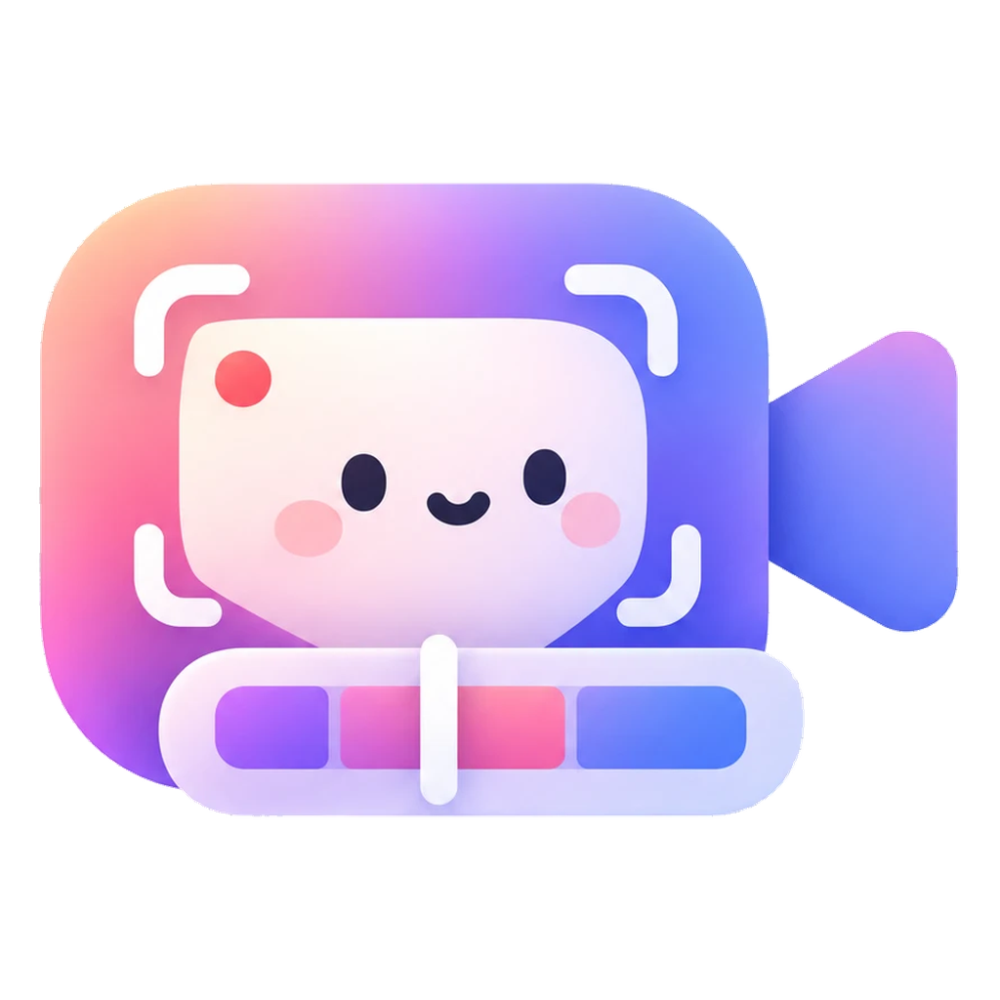
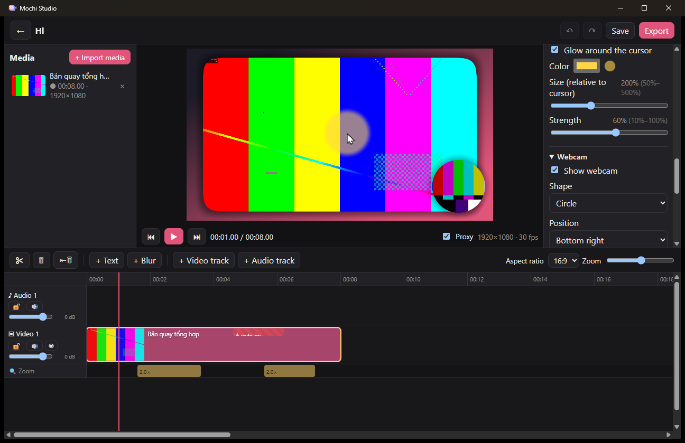

<p align="center">
  
</p>

<h1 align="center">Mochi Studio</h1>

<p align="center">
  <strong>Record your screen, get a polished video by default, and edit it on a real timeline — all on your own machine.</strong>
</p>

<p align="center">
  <a href="LICENSE"></a>
  
  
  
</p>

<p align="center">
  <strong>English</strong> · <a href="README.vi.md">Tiếng Việt</a>
</p>

<p align="center">
  
</p>

Mochi Studio is an open-source desktop app that combines a professional screen recorder with a video editor, in the spirit of **Camtasia**, with the "looks great out of the box" defaults of **Screen Studio**.

Every source (screen, webcam, microphone, system audio) is recorded as its own track, and the cursor is captured as **data rather than pixels**. That means zooms, cursor size, smoothing, click effects and highlights can all be changed after recording, without re-recording anything.

Everything runs locally. There is no account, no cloud upload, and no telemetry.

## Contents

- [Features](#features)
- [Status](#status)
- [Getting started](#getting-started)
- [Default shortcuts](#default-shortcuts)
- [Building from source](#building-from-source)
- [Architecture](#architecture)
- [Privacy](#privacy)
- [Contributing](#contributing)
- [License](#license)
- [Acknowledgements](#acknowledgements)

## Features

### Recording
- **Full screen, a single window, or a custom area**: drag to select, type exact pixel sizes, or use 16:9 / 9:16 / 1:1 / 4:3 presets.
- **Separate tracks** for screen, webcam, microphone and system audio, with a live webcam preview and level meters before you start.
- **Native-resolution capture** at 30 or 60 fps with three quality levels; hardware encoders (NVENC / Quick Sync / AMF) are used automatically, with a software fallback.
- **Global shortcuts** (rebindable, with conflict detection), a 0 / 3 / 5 / 10 second countdown, pause / resume (each part becomes a segment), and a small floating control bar that **never appears in the recording**.
- **Cursor highlight**: a soft glow around the pointer (color, size and strength) that appears in the editor and in exports, not on your screen while recording.
- **Opt-in keystroke capture**: off by default, with a "shortcuts only" mode; recording every key requires an explicit warning.
- **Window recording that follows the window** when you move it, with an option to capture **only that app's audio** (Windows 10 2004 or later), so notifications from other apps stay out.
- **Recording presets**: save named setups (area, sources, quality, countdown) and switch between them in one click.
- **Resilient by design**: fragmented MP4 recording with crash recovery, a safe stop when the disk fills up, and recording continues if a webcam or microphone is unplugged (the lost range is marked on the timeline).

### Auto-polish
When you stop recording, the project opens straight in the editor, already polished:
- background (color, gradient or image), padding, rounded corners and drop shadow;
- **automatic zoom** generated from your clicks and typing;
- smoothed cursor movement, a larger cursor, click ripples, and auto-hide when idle.

### Editing
- Multi-track timeline: drag and drop, split, trim, ripple delete, snapping, track lock, track and clip volume, and unlimited undo / redo.
- Real-time preview that is **identical to the export**, because preview and export share one GPU renderer.
- Editable zoom blocks on a dedicated track (level, spring-like easing, follow the cursor or a fixed point).
- Webcam picture-in-picture: corner or free position, circle / rounded / original shape, border, mirroring, and hide-per-range.
- Text overlays (with optional backing), blur and pixelate regions to hide sensitive information.
- Aspect ratios 16:9, 9:16, 1:1 and 4:3, with zooms and the webcam re-laid out automatically.
- Clip speed (0.25×–4×), fades, audio separation and waveforms.
- Imports MP4, MOV, MKV, WebM, MP3, WAV, M4A, PNG, JPG and animated GIF.
- **Motion**: keyframes for position, scale, rotation and opacity with easing; fade, slide and wipe transitions; text that types itself in.
- **Annotations**: callouts, arrows and shapes, spotlight regions, and an on-screen keystroke overlay built from the recorded keys.
- **Cursor effects**: spotlight, magnifier, click sounds, cursor styles and motion blur.
- **Webcam**: local AI background blur or removal, chroma key, and camera-only, split-screen and floating-card layouts.
- **Look**: brightness, contrast and saturation, borders, and laptop / phone device frames.
- **Audio clean-up, all local**: noise reduction, loudness normalization to −16 LUFS, a compressor, and automatic ducking of music under speech.
- **Local subtitles** with Whisper (the model is downloaded only after you agree): edit text and timing, style them, word-by-word animated captions, SRT / VTT import and export.
- Freeze frames, markers, clip groups, magnetic tracks, a brand theme (colors and font) and saved effect presets.
- Missing-media detection with relinking by folder, automatic proxies for 4K media, autosave every 60 seconds, and 10 rolling backups.

### Export
- **MP4** with H.264, plus HEVC and AV1 when your GPU supports them; presets for YouTube 1080p, 4K and 9:16 social video.
- **GIF** with an optimized palette, and a size warning for large GIFs.
- Export the whole project or an in / out range.
- **Audio only** (M4A / MP3), **WebM with a transparent background**, subtitles burned in or as an `.srt` file next to the video.
- **Batch export** several projects, or one file per marker; save the current frame as PNG; pack a project with all its media into a `.zip` for another computer.
- Export runs in a **separate process**: you can keep editing, cancel at any time, and queue several exports.

## Status

Mochi Studio is a **preview (0.2)**. Every use case planned for the first usable version (MVP) and for the full version (v1) is implemented. It has not had broad testing on many machines yet, so expect rough edges and please [report issues](../../issues).

- **Supported:** Windows 10 (1903 or later) and Windows 11, 64-bit.
- **Not yet:** macOS (planned later, since the capture layer is already abstracted) and Linux.
- **Later:** drawing on the screen while recording, and editing a video by editing its transcript.

The interface is available in **English** and **Vietnamese** and follows the system language by default.

## Getting started

### Install
Prebuilt Windows installers are published on the [Releases](../../releases) page when available. The NSIS installer (`*-setup.exe`) installs for the current user and does not need administrator rights.

The installer is not code-signed yet, so Windows SmartScreen may warn you. Choose **More info → Run anyway**.

### First recording
1. Click **New recording**, choose a screen, window or area, and turn on the sources you want.
2. Optionally enable **Cursor highlight**.
3. Press **Start recording** (or <kbd>F9</kbd>), then press <kbd>F10</kbd> to stop.
4. The polished project opens in the editor. Adjust it, then press <kbd>Ctrl</kbd>+<kbd>E</kbd> to export.

Recordings are saved to `Videos\Mochi Studio\` by default.

## Default shortcuts

| Action | Shortcut |
|---|---|
| Start recording / pause / resume | <kbd>F9</kbd> |
| Stop recording | <kbd>F10</kbd> |
| Cancel recording | <kbd>Shift</kbd>+<kbd>F10</kbd> |
| Play / pause | <kbd>Space</kbd> |
| Previous / next frame (10 frames with <kbd>Shift</kbd>) | <kbd>←</kbd> / <kbd>→</kbd> |
| Go to start | <kbd>Home</kbd> |
| Zoom timeline in / out | <kbd>+</kbd> / <kbd>-</kbd> |
| Split at playhead | <kbd>S</kbd> |
| Delete / ripple delete | <kbd>Delete</kbd> / <kbd>Shift</kbd>+<kbd>Delete</kbd> |
| Undo / redo | <kbd>Ctrl</kbd>+<kbd>Z</kbd> / <kbd>Ctrl</kbd>+<kbd>Y</kbd> |
| Set in / out point, clear range | <kbd>I</kbd> / <kbd>O</kbd>, <kbd>X</kbd> |
| Add a marker | <kbd>M</kbd> |
| Export | <kbd>Ctrl</kbd>+<kbd>E</kbd> |

You can rebind the recording shortcuts from the recording setup screen. If another app already uses a key, Mochi Studio suggests a free alternative.

## Building from source

### Prerequisites
- Windows 10 or 11 (x64)
- [Rust](https://rustup.rs/) (stable, 1.85 or newer; the workspace uses edition 2024)
- Visual Studio 2022 Build Tools with the **Desktop development with C++** workload
- **LLVM 19** for `bindgen`: `winget install LLVM.LLVM --version 19.1.7`
- [Node.js](https://nodejs.org/) 20 or newer and [pnpm](https://pnpm.io/) 10

### Steps
```powershell
# 1. Download FFmpeg 7.1 (shared) and DXC, and write .cargo/config.toml (safe to re-run)
powershell -ExecutionPolicy Bypass -File scripts/setup.ps1

# 2. Install frontend dependencies
pnpm install

# 3. Run the app in development mode
pnpm dev

# 4. Build the installers (NSIS + MSI) into target/release/bundle/
pnpm build
```

### Developer CLI
`mochi-cli` drives the same Rust core without the UI. It is useful for testing, and it is not shipped in the installer.

```powershell
cargo run -p mochi-cli -- targets                          # list displays, windows, microphones and webcams
cargo run -p mochi-cli -- record --secs 5 --system-audio   # record a 5-second test clip
cargo run -p mochi-cli -- --help                           # all commands (export, render-frame, scenarios…)
```

### Checks
```powershell
cargo check --workspace --tests
pnpm --dir apps/desktop typecheck
cargo deny --manifest-path apps/desktop/src-tauri/Cargo.toml check bans licenses sources
```

## Architecture

```
apps/desktop/          Tauri v2 shell (Rust) + React / TypeScript UI, English and Vietnamese i18n
crates/
  mochi-recorder/      recording service: state machine, preflight checks, device-loss handling
  mochi-project/       project format (project.json), locking, backups, migrations, media import
  mochi-timeline/      pure edit operations, timeline rules, undo / redo
  mochi-editor/        editing session: open / save, relink, autosave
  mochi-render/        multi-track GPU compositor (wgpu), shared by preview and export
  mochi-preview/       native preview surface (child HWND + wgpu swapchain), audio-clocked player
  mochi-export/        MP4 / GIF export in a child process, encoder probing, per-project queue
  mochi-jobs/          background jobs: proxies, thumbnails, waveforms, cache management
  mochi-cli/           developer CLI for real-world testing
vendor/cap/            vendored crates from Cap (capture, encoding, cursor rendering), with local patches
vendor/wgpu-hal/       patched wgpu-hal
```

A few design decisions:
- **The preview is rendered natively.** Frames never travel over IPC; the web UI only sends commands.
- **One renderer** produces both the preview and the export, so what you see is what you get.
- **Edits are non-destructive.** Original recordings and imported media are never modified; only `project.json` changes.
- **Capture builds on [Cap](https://github.com/CapSoftware/Cap).** Its crates are vendored under `vendor/cap/`. Every local change is marked `[MOCHI]` in the code and listed in [`vendor/cap/PROVENANCE.md`](vendor/cap/PROVENANCE.md).

> Note: most code comments and internal notes are written in Vietnamese. Identifiers, commit-facing docs and this README are in English.

## Privacy

- Mochi Studio does not upload media, recordings or project data anywhere, and works fully offline.
- It contains no telemetry and no automatic crash reporting.
- This is enforced at build time: [`deny.toml`](deny.toml) bans HTTP clients, HTTP servers, WebSocket libraries and telemetry crates from the dependency graph, and `cargo deny` fails the build if one sneaks in.
- Keystroke capture is off by default, and capturing every key requires an explicit opt-in with a warning.

## Contributing

Bug reports, ideas and pull requests are welcome. Please read [CONTRIBUTING.md](CONTRIBUTING.md) first, and see [SECURITY.md](SECURITY.md) for reporting vulnerabilities privately. This project follows a [Code of Conduct](CODE_OF_CONDUCT.md).

## License

Mochi Studio is licensed under the **GNU Affero General Public License v3.0 only** ([LICENSE](LICENSE)).

It includes third-party code under other licenses:
- Cap crates under AGPL-3.0, with `scap-*` and `cap-camera*` under MIT;
- RNNoise (BSD-3-Clause);
- a patched wgpu-hal (MIT OR Apache-2.0);
- FFmpeg 7.1, distributed with the binaries under GPL-3.0.

See [NOTICE](NOTICE) and [THIRD_PARTY.md](THIRD_PARTY.md) for details. Installed copies include these notices in the `licenses/` folder.

## Acknowledgements

- [Cap](https://github.com/CapSoftware/Cap), the open-source Loom alternative whose capture, encoding and cursor-rendering crates power Mochi's recorder.
- [FFmpeg](https://ffmpeg.org/), [Tauri](https://tauri.app/), [wgpu](https://wgpu.rs/), [gifski](https://gif.ski/) and the wider Rust and React ecosystems.
- Camtasia and Screen Studio, for setting the bar for what a screen recording tool should feel like.
